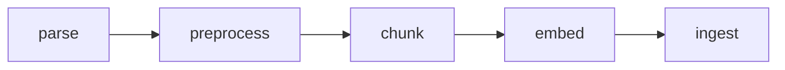

# 문서 적재 파이프라인

HWP·HWPX·PDF 공고문을 부모-자식 청크로 나눠 PostgreSQL 또는 OpenSearch에 적재합니다. 설계는 [SPEC.md](SPEC.md)에 있습니다.



## 실행 준비

Python 3.12, [uv](https://docs.astral.sh/uv/), Node.js 22가 필요합니다. 저장소는 pgvector와 pg_search(0.26.3에서 확인)가 설치된 PostgreSQL, 또는 analysis-nori 플러그인이 설치된 OpenSearch를 씁니다.

1. Python 의존성을 설치합니다.

   ```sh
   uv sync
   ```

2. Node 의존성을 설치합니다. kordoc 엔진(4.24.11 고정)과 promptfoo가 들어옵니다.

   ```sh
   npm install
   ```

3. `.env.example`을 `.env`로 복사하고 값을 채웁니다.

   PostgreSQL은 표준 `PG*` 변수(`PGHOST`, `PGPORT`, `PGUSER`, `PGPASSWORD`, `PGDATABASE`)로 접속합니다. OpenSearch는 `OPENSEARCH_URL`과 `OPENSEARCH_PORT`를 이어 붙인 주소로 접속합니다. `OPENSEARCH_USER`가 있으면 기본 인증을 쓰고, `OPENSEARCH_CERT_FILE`이 있으면 그 CA 인증서로 TLS를 검증합니다.

   임베딩 서버는 OpenAI 호환 `/v1/embeddings`를 제공해야 합니다. `EMBEDDING_BASE_URL`과 `EMBEDDING_PORT`를 이어 붙인 주소 뒤에 `/v1`을 붙여 접속합니다. `EMBEDDING_BASE_URL`에 스킴이 없으면 `http://`로 봅니다. `EMBEDDING_MODEL`은 `config.yaml`에 있는 모델 이름 중 하나여야 합니다.

   `llm` 판정기는 `LLM_BASE_URL`(`/v1` 포함), `LLM_API_KEY`, `LLM_MODEL`을 씁니다. `jev` 판정기는 `TYPESAFE_BASE_URL`과 `TYPESAFE_API_KEY`를 씁니다. 모델은 기본 `typesafe/jev-router`이고 `TYPESAFE_MODEL`로 바꿀 수 있습니다.

## 사용 방법

`samples/`의 모든 문서를 적재합니다.

```sh
uv run ingest
```

판정기와 저장소를 고를 수 있습니다.

```sh
uv run ingest --judge llm --store opensearch
```

| 옵션 | 값 | 기본값 |
|---|---|---|
| `--judge` | `rule-based`, `llm`, `jev` | `rule-based` |
| `--store` | `postgres`, `opensearch` | `postgres` |
| `--samples` | 문서 디렉토리 | `samples` |

문서마다 한 줄씩 결과를 출력합니다.

```text
성공 2015년 제주첨단과학기술단지 산업시설용지 재공급 공고문.hwp: 부모 5개, 자식 10개
...
7개 중 7개 성공, 0개 실패
```

한 문서가 실패해도 나머지는 계속 처리합니다. 실패가 하나라도 있으면 종료 코드는 1입니다. 설정 오류는 문서를 읽기 전에 종료 코드 2로 끝납니다. 청크가 하나도 나오지 않은 문서는 kordoc 경고(스캔 PDF의 `NEEDS_OCR` 등)를 붙여 실패로 알립니다.

같은 문서를 다시 적재하면 그 문서(파일명)의 기존 레코드를 지우고 새로 넣습니다. 여러 번 적재해도 레코드 수는 같습니다.

## 단계별 설명

### parse

`parser.py`가 kordoc Python 클라이언트로 문서를 파싱합니다. 표는 HTML로 받고 이미지는 받지 않습니다. 결과 dict에 NFC로 정규화한 파일명을 `source`로 더합니다.

마크다운은 모두 `render.mjs` 하나로 만듭니다. 이 스크립트는 kordoc의 `blocksToMarkdown`에 내부 함수 `toHtmlTables`를 이어 붙입니다. `toHtmlTables`는 공개 API가 아니어서 스크립트가 dist 청크의 export 목록에서 찾습니다. kordoc 버전을 올리면 이 부분을 다시 확인해야 합니다. 렌더링은 블록 묶음 여러 개를 Node 프로세스 한 번에 넘깁니다.

### preprocess

`preprocessor.py`는 원본을 복사해서 아래 순서로 정리합니다.

1. 이미지 블록과 표 셀 안의 이미지 표시를 지웁니다.
2. 셀 안에 블록이 든 1열 표(틀 표)를 안의 블록으로 펼칩니다.
3. kordoc이 붙인 제목을 모두 본문으로 되돌리고 판정기 결과로 제목을 다시 정합니다. 표가 제목이면 셀 텍스트가 제목 텍스트가 됩니다.
4. 연속된 레벨 1 제목을 하나로 합칩니다.
5. 문서 마크다운, 페이지별 마크다운, 목차(outline)를 다시 만듭니다.

### 제목 판정

`judge.py`의 세 판정기는 같은 인터페이스(`judge(blocks) -> {블록 번호: 레벨}`)를 가집니다.

`rule-based`는 외부 호출 없이 번호 기호로 판정합니다. 기호 종류는 `_MARKERS` 표에 있습니다. 문서마다 처음 나온 기호가 그 위치의 한 단계 아래 레벨을 받고, 같은 기호는 이후에도 같은 레벨입니다. 장 체계(편, 장, 로마 숫자)가 없는 문서는 레벨 3을 두지 않습니다. 길이, 서술 어미, 목차 점선과 페이지 번호, 날짜로 제목이 아닌 줄을 거릅니다. 앞뒤가 같은 기호인 나열 항목과 번호가 다시 시작하는 하위 목록도 거릅니다. 평평한 문서에서 다른 기호가 나와도 글자 크기가 레벨 2 제목 이상이면 레벨 2로 봅니다. PDF의 `□ 접수처`가 이 경우입니다.

`llm`은 블록마다 번호를 붙인 문서 전체를 한 번에 보내고 제목 목록을 JSON 스키마 구조화 출력으로 받습니다. 응답 텍스트가 그 번호의 블록과 맞지 않으면 버립니다.

`jev`는 100자 이하 블록마다 제목인지 묻고, 제목이면 레벨을 묻습니다. 같은 페이지 블록과 앞서 정한 제목을 함께 보냅니다. 확신도가 0.7보다 낮은 답은 버립니다. OpenRouter의 `typesafe/jev-router`는 logprob을 돌려주지 않아서, 확신도는 모델이 구조화 출력으로 직접 답한 값입니다.

### chunk

`chunker.py`는 복원한 제목으로 청크를 나눕니다.

- 레벨 1·2 제목마다 부모를 엽니다. 자식이 없는 부모는 버립니다.
- 부모 안에서 레벨 3 제목마다 자식을 나누고, 10,000자를 넘는 덩어리는 블록 단위로 자릅니다.
- 렌더링 결과가 `<table>`인 표는 따로 자식이 되고 바로 앞 문단을 함께 담습니다. 그 문단은 다른 자식에 들어가지 않습니다. 렌더링해도 표가 되지 않는 1행 상자는 글로 다룹니다.
- 자식은 `# 문서 제목`, `## 장 제목`, `### 절 제목` 경로로 시작합니다.
- 메타데이터는 `source`, `title`, `pages`입니다.

### embed

`embedder.py`는 문서 하나의 자식 청크를 모두 요청 한 번에 보냅니다. 부모는 임베딩하지 않습니다. `config.yaml`의 `document_prefix`를 앞에 붙이고, 접두어에 `{title}`이 있으면 청크 첫 줄의 문서 제목을 그 자리로 옮깁니다.

### ingest

`ingester.py`의 두 저장소는 같은 인터페이스(`ingest`, `count`)를 가집니다. 스키마와 인덱스는 없으면 만듭니다.

- PostgreSQL은 `parents`, `children` 테이블을 씁니다. 문서 하나를 한 트랜잭션으로 지우고 넣으며, 부모를 지우면 자식이 함께 지워집니다. `children`에는 코사인 HNSW 인덱스와 lindera 한국어 토크나이저를 쓰는 BM25 인덱스가 있습니다. pg_search 0.26.3에서 확인했습니다.
- OpenSearch는 모델마다 `{index_name}-parents`, `{index_name}-children` 인덱스를 둡니다. children의 `text`는 렌더러 표 태그만 지운 뒤 nori로 분석하므로, 본문의 `<공급 대상 토지 위치도>` 같은 꺾쇠 표현은 남습니다. 기존 인덱스의 임베딩 차원이 설정과 다르면 기존 데이터를 지우기 전에 멈춥니다.

PostgreSQL 테이블은 모델과 상관없이 하나입니다. 차원이 다른 모델로 바꾸면 적재가 실패하고 기존 데이터는 남습니다. 그때는 테이블을 지우고 다시 적재합니다.

## 평가 방법

`evals/`는 promptfoo로 세 판정기의 제목 복원 결과를 비교합니다. 정답은 `evals/tests/test_cases.yaml`에 있습니다.

```sh
cd evals
PROMPTFOO_PYTHON=../.venv/bin/python npx promptfoo eval -c promptfooconfig.yaml
npx promptfoo view
```

판정기 하나만 돌리려면 `--filter-providers rule-based`를 붙입니다. 채점은 `scoring.py`가 정답 목록과 예측 목록을 순서대로 맞춰(최장 공통 부분열) precision, recall, F1을 냅니다. 텍스트는 렌더러 태그와 공백을 지우고 비교합니다. 결과의 reason에 놓친 제목(missed)과 잘못 잡은 제목(spurious)이 남습니다. 통과 기준은 PDF가 F1 0.95, 나머지가 F1 1.0입니다.

promptfoo 없이 바로 점수를 보려면 아래 명령을 씁니다.

```sh
uv run python evals/scoring.py --judge rule-based
```

## 테스트 방법

테스트는 외부 서비스 없이 돕니다. 임베딩 API와 OpenSearch는 가짜로 대신하고, kordoc 렌더링에는 로컬 Node를 씁니다.

```sh
uv run pytest
uv run ruff check .
uv run ruff format --check .
```
