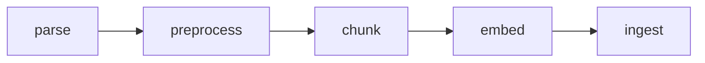
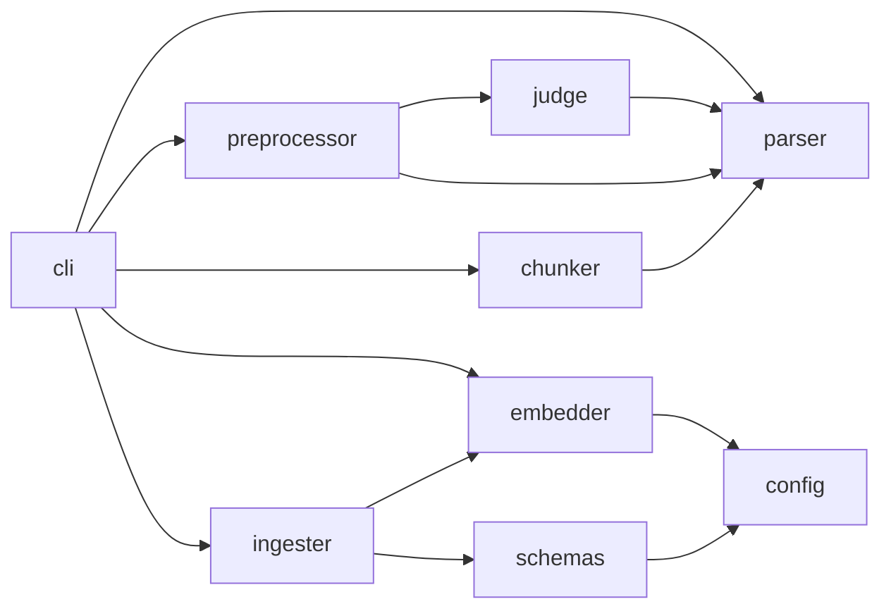

# 문서 적재 파이프라인 설계

HWP·HWPX·PDF 공고문과 안내서를 RAG 검색에 쓸 수 있도록 부모-자식 청크로 나눠 PostgreSQL 또는 OpenSearch에 적재하는 파이프라인입니다.

공문서는 kordoc으로 파싱하면 블록 목록이 나오지만, 제목 계층이 정확하지 않아 그대로 청크를 나누면 장·절 경계가 무너집니다. 그래서 파이프라인의 중심은 제목 계층 복원입니다. 복원한 계층을 기준으로 청크를 나누고, 청크마다 제목 경로를 붙여 단독으로 읽혀도 맥락이 남게 합니다.



## 1. 목표와 범위

목표는 아래와 같습니다.

- HWP·HWPX·PDF를 같은 방식으로 처리합니다.
- 문서의 제목 계층을 레벨 1~3으로 복원합니다.
- 장 단위 부모 청크와 절·표 단위 자식 청크를 만듭니다.
- 자식 청크를 임베딩해 벡터 검색과 키워드 검색을 함께 쓸 수 있게 적재합니다.
- 제목 판정 방식을 바꿔 끼우고 평가로 비교할 수 있게 합니다.

범위에 넣지 않는 것은 아래와 같습니다.

- 검색 API와 재순위화
- OCR과 이미지 설명. 스캔 PDF는 실패로 알립니다.
- 문서 일부만 갱신하는 기능. 같은 문서를 다시 적재하면 통째로 바꿉니다.

## 2. 구성

### 기술 스택

- Python 3.12, uv. `ingest` 명령을 패키지 스크립트로 제공합니다.
- kordoc: 문서 파싱과 마크다운 렌더링에 씁니다. Python 클라이언트가 Node 엔진을 띄워 동작합니다.
- OpenAI 호환 API: 임베딩과 LLM 판정에 씁니다.
- TypeSafe(Jev): 블록 단위 제목 판정에 씁니다.
- PostgreSQL: pgvector로 벡터 검색, pg_search로 BM25 키워드 검색을 합니다.
- OpenSearch: knn 벡터 검색과 nori 한국어 분석을 씁니다.
- promptfoo: 평가에, pytest와 ruff: 테스트와 린트에 씁니다.

### 디렉토리 구조

```text
.
├── config.yaml                 # 임베딩 모델별 설정
├── samples/                    # 적재할 문서
├── src/document_ingestion_pipeline/
│   ├── parser.py               # 파싱과 렌더링
│   ├── render.mjs              # kordoc 렌더러를 부르는 Node 스크립트
│   ├── judge.py                # 제목 판정기
│   ├── preprocessor.py         # 블록 정리와 제목 복원
│   ├── chunker.py              # 부모·자식 청크
│   ├── config.py               # 모델 설정 읽기
│   ├── embedder.py             # 임베딩
│   ├── schemas.py              # 저장소 스키마
│   ├── ingester.py             # 적재
│   └── cli.py                  # ingest 명령
├── evals/                      # 제목 복원 평가
└── tests/
```

### 모듈 관계



파싱, 전처리, 청킹은 외부 서비스 없이 동작하고 순수하게 입력에서 출력을 만듭니다. 외부 서비스는 판정기(LLM, Jev), 임베딩, 적재에만 있습니다.

## 3. 데이터 흐름

데이터는 kordoc의 블록 목록을 중심으로 흐릅니다. 별도 모델 클래스를 만들지 않고 kordoc이 내는 dict 형식을 이어받습니다.

| 단계 | 출력 |
|---|---|
| parse | kordoc 파싱 결과. 블록 목록, 문서 마크다운, 페이지 목록, 경고 등에 파일명(`source`)을 더한 것 |
| preprocess | 같은 형식에서 블록이 정리되고, 제목 블록이 `heading`과 레벨 1~3을 갖고, 마크다운과 목차(outline)가 다시 만들어진 것 |
| chunk | 부모 청크 목록. 부모마다 텍스트, 메타데이터, 자식 청크 목록을 가짐 |
| ingest | 저장소의 부모·자식 레코드 |

블록은 문단, 목록, 표, 이미지, 제목 등의 타입과 텍스트, 페이지 번호를 가집니다. 표는 행·열 수와 셀 목록을 가지고, 셀 안에 다시 블록이 들어 있을 수 있습니다.

청크 메타데이터는 파일명, 문서 제목(레벨 1 제목), 페이지 목록입니다.

## 4. 모듈 설계

### parser

kordoc으로 문서를 파싱하고, 블록을 마크다운으로 렌더링하는 창구입니다.

- 표는 HTML로 받고 이미지는 받지 않습니다. 표 구조(병합 셀 등)를 잃지 않기 위해서입니다.
- 파일명은 NFC로 정규화합니다. macOS 파일명은 NFD라서 그대로 두면 같은 이름이 다르게 저장됩니다.
- 파이프라인의 모든 마크다운은 kordoc 렌더러 하나로 만듭니다. 표는 HTML `<table>`, 제목은 `#` 마크다운으로 렌더링합니다. kordoc이 이 조합을 공개 API로 내지 않아 Node 스크립트에서 내부 함수를 찾아 쓰므로, kordoc 버전(4.24.11)을 고정합니다.
- Node 프로세스를 띄우는 비용이 크므로 렌더링은 여러 블록 묶음을 한 번에 넘겨 묶음마다 결과를 받습니다.
- 텍스트를 비교할 때는 렌더러 태그와 공백을 지운 형태로 비교하는 공용 유틸을 둡니다. 판정 결과 검증과 평가 채점에서 씁니다.

### judge

블록 목록을 받아 어떤 블록이 몇 레벨 제목인지 정합니다. 판정기 세 가지를 같은 인터페이스 뒤에 두고 이름으로 고릅니다.

레벨 기준은 모든 판정기가 같습니다.

| 레벨 | 대상 |
|---|---|
| 1 | 문서 제목. 여러 줄에 걸쳐 있으면 모두 레벨 1 |
| 2 | 장 제목, 독립된 첨부·서식 제목 |
| 3 | 장으로 나뉜 문서(`Ⅰ.`, `제1장` 등)의 절 제목, 장 아래의 첨부·서식 제목 |

제목이 아닌 것은 아래와 같습니다.

- 목차
- 번호가 붙었더라도 사실이나 지시를 서술하는 문장
- 본문 없이 이어지는 나열 항목
- 날짜와 발행 기관명
- 레벨 3보다 깊은 항목
- 장 안의 `□`, `ㅇ` 같은 글머리 항목

**rule-based**는 외부 호출 없이 번호 기호로 판정합니다.

- 문서마다 번호 체계가 다르므로 레벨을 기호에 고정하지 않습니다. 처음 나온 기호가 그 위치의 한 단계 아래 레벨을 받고, 이후 같은 기호는 같은 레벨입니다.
- 장 체계(편·장·로마 숫자)가 있는 문서만 레벨 3을 둡니다. `1.`, `①`, `□`로 시작하는 평평한 문서는 그 기호가 레벨 2이고 안쪽은 본문입니다.
- 문서 제목은 문서 맨 앞에서 번호 기호나 날짜가 나오기 전까지의 짧은 줄들입니다.
- 길이, 서술 어미(`~다`, `~함`), 목차 점선과 페이지 번호로 제목이 아닌 줄을 거릅니다.
- 앞뒤 블록을 보고 나열 항목을 거르고, 번호가 처음부터 다시 시작하면 하위 목록으로 봅니다.
- 1행짜리 상자 표에 든 장 제목도 제목으로 봅니다.

**llm**은 블록마다 번호를 붙인 문서 전체를 한 번에 보내 제목 목록을 구조화 출력으로 받습니다. 문서 전체를 보므로 목차와 번호 체계를 근거로 삼을 수 있습니다. 응답한 텍스트가 해당 블록과 맞지 않으면 버려, 모델이 번호를 잘못 짚는 것을 막습니다.

**jev**는 블록마다 먼저 제목인지 묻고, 제목이면 레벨을 묻습니다. 같은 페이지 내용과 앞서 판정한 제목을 함께 넘겨 맥락을 줍니다. 확신도가 낮은 답은 버립니다.

### preprocessor

파싱한 블록을 청킹하기 좋은 형태로 정리하고 제목 계층을 복원합니다. 원본 파싱 결과는 바꾸지 않습니다.

- **이미지 제거.** 이미지 블록과 표 셀 안의 이미지 표시를 지웁니다.
- **틀 표 풀기.** 한글 문서는 본문 전체를 1열 표로 감싸는 경우가 많습니다. 셀 안에 블록이 든 1열 표는 틀로 보고 안의 블록으로 펼칩니다.
- **제목 재판정.** kordoc이 붙인 제목은 신뢰하지 않고 모두 본문으로 되돌린 뒤 판정기 결과로만 제목을 정합니다. 표가 제목으로 판정되면 셀 텍스트를 제목 텍스트로 씁니다.
- **문서 제목 합치기.** 여러 줄로 찍힌 문서 제목은 레벨 1 제목 하나로 합칩니다.
- **결과 갱신.** 바뀐 블록으로 문서 마크다운, 페이지별 마크다운, 목차를 다시 만듭니다.

### chunker

복원한 제목 계층으로 청크를 나눕니다.

- **부모는 장 단위입니다.** 레벨 2 이하 제목마다 새 부모를 엽니다. 검색된 자식의 주변 맥락을 LLM에 넘길 때 씁니다.
- **자식은 절 단위입니다.** 부모 안에서 레벨 3 제목마다 나눕니다. 너무 긴 덩어리는 10,000자 기준으로 자릅니다.
- **표는 따로 자식이 됩니다.** 표마다 자식 하나를 만들고 표 바로 앞 문장(보통 표를 설명하는 문장)을 함께 담습니다. 그 문장이 다른 자식에 겹쳐 들어가지 않게 합니다.
- **상자 표는 글로 봅니다.** 렌더링해도 표가 되지 않는 1행 상자는 일반 글로 다룹니다.
- **청크는 제목 경로로 시작합니다.** `# 문서 제목`, `## 장 제목`, `### 절 제목`을 앞에 붙여 청크 하나만 읽어도 어느 문서의 어느 부분인지 알 수 있게 합니다.

### config, embedder

- 임베딩 모델별 설정(차원, OpenSearch 인덱스 이름, 문서 접두어)은 `config.yaml`에 두고 `EMBEDDING_MODEL`로 고릅니다. 설정에 없는 모델이나 잘못된 키는 바로 에러를 냅니다.
- 임베딩은 OpenAI 호환 API 하나로 하고, 모든 자식 청크를 요청 한 번에 보냅니다.
- 모델마다 문서 쪽 입력 형식이 다르므로 접두어를 설정으로 받습니다. 접두어에 `{title}`이 있으면 청크 첫 줄의 문서 제목을 그 자리에 옮깁니다(embeddinggemma의 `title: ... | text: ...` 형식).
- 부모 청크는 임베딩하지 않습니다.

### schemas, ingester

- 저장소는 PostgreSQL과 OpenSearch 두 가지이고, 같은 인터페이스 뒤에 두고 이름으로 고릅니다.
- 스키마는 적재할 때 없으면 만듭니다. 벡터 차원과 인덱스 이름은 모델 설정에서 가져옵니다.
- 적재는 문서(파일명) 단위로 기존 데이터를 지우고 다시 넣습니다. 같은 문서를 여러 번 적재해도 결과가 같습니다.
- PostgreSQL은 문서 하나를 한 트랜잭션으로 적재하고, 부모를 지우면 자식이 함께 지워집니다.
- OpenSearch는 모델마다 인덱스를 따로 둡니다. 임베딩 차원이 설정과 다르면 기존 데이터를 지우기 전에 멈춥니다.

### cli

`ingest` 명령은 `samples/`의 모든 문서를 적재합니다.

- 판정기(`rule-based`, `llm`, `jev`, 기본 `rule-based`)와 저장소(`postgres`, `opensearch`, 기본 `postgres`)를 옵션으로 고릅니다.
- 문서 하나가 실패해도 나머지는 계속 처리하고, 문서마다 성공과 실패를 출력합니다. 실패가 있으면 0이 아닌 코드로 끝납니다.
- 청크가 하나도 나오지 않은 문서는 kordoc 경고(스캔 PDF의 `NEEDS_OCR` 등)를 담아 실패로 알립니다. 빈 문서가 조용히 적재된 것처럼 보이지 않게 하기 위해서입니다.

## 5. 설정

### config.yaml

```yaml
models:
  nlpai-lab/KURE-v1:
    index_name: kure-v1
    dimension: 1024
  BGE-m3-ko:
    index_name: bge-m3-ko
    dimension: 1024
  BAAI/bge-m3:
    index_name: bge-m3
    dimension: 1024
  google/embeddinggemma-2:
    index_name: embeddinggemma-2
    dimension: 768
    document_prefix: "title: {title} | text: "
```

### 환경변수

`.env.example`의 변수를 씁니다. 임베딩 API는 `EMBEDDING_BASE_URL`과 `EMBEDDING_PORT`를 이은 주소의 `/v1`, OpenSearch는 `OPENSEARCH_URL`과 `OPENSEARCH_PORT`를 이은 주소로 접속합니다. PostgreSQL은 표준 `PG*` 변수로 접속합니다.

## 6. 저장 스키마

### PostgreSQL

| 테이블 | 컬럼 |
|---|---|
| `parents` | `id`, `text`, `metadata`(jsonb) |
| `children` | `id`, `parent_id`(→ `parents`, 삭제 시 함께 삭제), `text`, `embedding`(vector), `metadata`(jsonb) |

`children`에는 코사인 거리 HNSW 벡터 인덱스와, 한국어 토크나이저(lindera)를 쓰는 pg_search BM25 인덱스를 둡니다.

### OpenSearch

모델마다 `{index_name}-parents`, `{index_name}-children` 인덱스를 둡니다.

- children의 `embedding`은 HNSW knn 벡터(코사인)입니다.
- children의 `text`는 nori로 분석합니다. 분석 전에 렌더러가 넣은 표 태그만 지우고, 본문의 `<...>` 꺾쇠 표현은 남깁니다.
- 부모 텍스트는 색인하지 않고 보관만 합니다.
- 메타데이터의 파일명과 문서 제목은 keyword, 페이지는 integer입니다.

## 7. 평가

promptfoo로 세 판정기의 제목 복원 결과를 비교합니다.

- 판정기마다 provider를 하나씩 두고, provider는 문서를 파싱·전처리해 제목 목록(레벨, 텍스트)을 냅니다.
- 채점은 정답 제목 목록과 예측 목록을 순서대로 맞춰 precision, recall, F1을 냅니다. 텍스트는 태그와 공백을 지우고 비교합니다.
- 놓친 제목과 잘못 잡은 제목을 결과에 남겨 어디서 틀렸는지 볼 수 있게 합니다.
- 정답은 `evals/tests/test_cases.yaml`에 문서 경로와 제목 목록으로 둡니다(부록 A).

## 8. 테스트

외부 서비스 없이 도는 단위 테스트를 둡니다. 임베딩 API와 OpenSearch는 가짜로 대신합니다. 테스트 이름은 동작을 문장으로 적습니다.

| 대상 | 확인할 것 |
|---|---|
| rule-based 판정 | 문서 고유의 중첩, 평평한 번호 체계, 장 안의 글머리 항목, 나열 항목, 서술 문장, 목차, 날짜에서 끝나는 문서 제목, 상자 표 장 제목, 첨부·서식의 레벨, 번호 재시작 |
| 전처리 | kordoc 제목 대체, 따로 찍힌 서식 라벨, 여러 줄 문서 제목 합치기, 이미지 제거, 틀 표 풀기 |
| 청킹 | 제목 경로 접두, 장별 부모, 표와 앞 문장 묶기, 문서 제목 메타데이터 |
| CLI | 텍스트 없는 문서의 실패 처리 |
| 설정·임베딩 | 모델 설정 읽기와 에러, 접두어와 `{title}` 처리, 요청 한 번 |
| 스키마·적재 | 모델별 인덱스, 분석기 태그 처리, 접속 설정, 차원 불일치 시 기존 데이터 보존 |

## 9. 완료 기준

- 테스트와 린트가 통과합니다.
- `samples/`의 7개 문서가 모두 적재되고, 다시 적재해도 레코드 수가 같습니다.
- rule-based 판정기가 제목 평가에서 PDF를 뺀 6개 문서는 F1 1.0, PDF 문서는 0.95 이상입니다.
- README에 실행 준비, 사용 방법, 단계별 설명, 평가 방법, 테스트 방법을 적습니다.

## 부록 A. 제목 정답

```yaml
- description: "2015년 제주첨단과학기술단지 산업시설용지 재공급 공고문"
  vars:
    path: "samples/2015년 제주첨단과학기술단지 산업시설용지 재공급 공고문.hwp"
    headings:
      - {level: 1, text: "제주첨단과학기술단지 산업시설용지 재공급(2차) 공고문"}
      - {level: 2, text: "□ 대상 토지 개요"}
      - {level: 2, text: "□ 입주대상 및 자격"}
      - {level: 2, text: "□ 분양신청 및 선정 방법"}
      - {level: 2, text: "□ 공급 일정"}
      - {level: 2, text: "□ 유의사항"}

- description: "2016년 제주첨단과학기술단지 산업시설용지 분양 공고문"
  vars:
    path: "samples/2016년 제주첨단과학기술단지 산업시설용지 분양 공고문.hwp"
    headings:
      - {level: 1, text: "제주첨단과학기술단지 산업시설용지 분양 공고"}
      - {level: 2, text: "1. 공급 대상 용지 개요"}
      - {level: 2, text: "2. 입주대상 및 자격"}
      - {level: 2, text: "3. 분양신청 및 선정 방법"}
      - {level: 2, text: "5. 분양가격 및 대금납부방법"}
      - {level: 2, text: "6. 정산"}
      - {level: 2, text: "6. 토지사용 승낙 및 소유권 이전"}
      - {level: 2, text: "7. 처분제한 및 준수사항"}
      - {level: 2, text: "8. 공급 일정 및 관련 유의사항"}
      - {level: 2, text: "9. 공사 및 건축관련 유의사항"}
      - {level: 2, text: "10. 기타사항"}

- description: "2017년 제주첨단과학기술단지 산업시설용지 분양 공고문"
  vars:
    path: "samples/2017년 제주첨단과학기술단지 산업시설용지 분양 공고문.hwp"
    headings:
      - {level: 1, text: "제주첨단과학기술단지 산업시설용지 분양 공고"}
      - {level: 2, text: "1. 공급 대상 용지 개요"}
      - {level: 2, text: "2. 입주대상 및 자격"}
      - {level: 2, text: "3. 분양신청 및 선정 방법"}
      - {level: 2, text: "5. 분양가격 및 대금납부방법"}
      - {level: 2, text: "6. 정산"}
      - {level: 2, text: "6. 토지사용 승낙 및 소유권 이전"}
      - {level: 2, text: "7. 처분제한 및 준수사항"}
      - {level: 2, text: "8. 공급 일정 및 관련 유의사항"}
      - {level: 2, text: "9. 공사 및 건축관련 유의사항"}
      - {level: 2, text: "10. 기타사항"}

- description: "2020년 제주영어교육도시 도시개발사업 조성용지 공급공고"
  vars:
    path: "samples/2020년 제주영어교육도시 도시개발사업 조성용지 공급공고.hwp"
    headings:
      - {level: 1, text: "제주영어교육도시 도시개발사업 조성용지 공급 공고"}
      - {level: 2, text: "1. 공급대상 및 공급방법"}
      - {level: 2, text: "2. 신청자격"}
      - {level: 2, text: "3. 공급일정 및 장소"}
      - {level: 2, text: "4. 입찰서 제출"}
      - {level: 2, text: "5. 입찰보증금 납부, 반환 및 귀속"}
      - {level: 2, text: "6. 낙찰자 결정방법"}
      - {level: 2, text: "7. 계약체결 시 구비서류"}
      - {level: 2, text: "8. 대금납부"}
      - {level: 2, text: "9. 용지사용 및 소유권이전"}
      - {level: 2, text: "10. 명의변경에 관한 사항"}
      - {level: 2, text: "11. 주요세금 및 신고사항"}
      - {level: 2, text: "12. 연기 또는 취소"}
      - {level: 2, text: "13. 기타 유의사항"}

- description: "2025년 8월 제주첨단과학기술단지 스마트빌딩 입주 안내서"
  vars:
    path: "samples/2025년 8월 제주첨단과학기술단지 스마트빌딩 입주안내서.hwp"
    headings:
      - {level: 1, text: "-  제주첨단과학기술단지 스마트빌딩 -\n입  주  안  내  서"}
      - {level: 2, text: "Ⅰ. 입주안내 개요"}
      - {level: 2, text: "Ⅱ. 임대시설 개요"}
      - {level: 2, text: "Ⅲ. 임대대상 및 가격"}
      - {level: 2, text: "Ⅳ. 입주대상 업종 및 자격"}
      - {level: 2, text: "Ⅴ. 입주자 선정방법"}
      - {level: 2, text: "Ⅵ. 임 대 료"}
      - {level: 2, text: "Ⅶ. 관 리 비"}
      - {level: 2, text: "Ⅷ. 공급 일정"}
      - {level: 2, text: "Ⅸ. 입주신청 및 계약체결 유의사항"}
      - {level: 2, text: "Ⅹ. 첨 부(제출 서류 양식)"}
      - {level: 3, text: "[서식 제1호]"}
      - {level: 3, text: "[서식 제2호]"}
      - {level: 3, text: "[서식 제3호]"}

- description: "2026년 제주영어교육도시 도시개발사업 잔지 공급 공고"
  vars:
    path: "samples/2026년 제주영어교육도시 도시개발사업 잔지 공급 공고.hwp"
    headings:
      - {level: 1, text: "제주영어교육도시 도시개발사업 잔지 공급 공고"}
      - {level: 2, text: "1. 공급대상 및 공급방법"}
      - {level: 2, text: "2. 입찰참가자격 : 실수요자로서 아래에 해당하는 자"}
      - {level: 2, text: "3. 공급일정 및 장소"}
      - {level: 2, text: "4. 입찰서 제출"}
      - {level: 2, text: "5. 입찰보증금 납부, 반환 및 귀속"}
      - {level: 2, text: "6. 낙찰자 결정방법"}
      - {level: 2, text: "7. 계약체결 시 구비서류"}
      - {level: 2, text: "8. 대금납부"}
      - {level: 2, text: "9. 용지사용 및 소유권이전"}
      - {level: 2, text: "10. 주요세금 및 신고사항"}
      - {level: 2, text: "11. 연기 또는 취소"}
      - {level: 2, text: "12. 청렴계약 이행준수"}
      - {level: 2, text: "13. 기타 유의사항"}

- description: "2026년 제주첨단과학기술단지 2단지 분양공고문"
  vars:
    path: "samples/2026년 제주첨단과학기술단지 2단지 분양공고문.pdf"
    headings:
      - {level: 1, text: "제주첨단과학기술단지 2단지 산업시설용지 1차 분양공고문"}
      - {level: 2, text: "① 공급 대상 토지 및 공급금액"}
      - {level: 2, text: "② 입주대상 업종 및 신청 자격"}
      - {level: 2, text: "③ 입주대상자 선정 우선순위 (내림차 순)"}
      - {level: 2, text: "④ 입주 신청 유의 사항 및 안내"}
      - {level: 2, text: "⑤ 대금납부"}
      - {level: 2, text: "⑥ 토지 사용 가능 시기, 면적 및 가격정산, 소유권 이전"}
      - {level: 2, text: "⑦ 처분제한 및 준수사항"}
      - {level: 2, text: "⑧ 주요 세금 및 신고사항"}
      - {level: 2, text: "⑨ 기타 유의 사항"}
      - {level: 2, text: "□ 접수처 : 제주국제자유도시개발센터 첨단운영처"}
```
